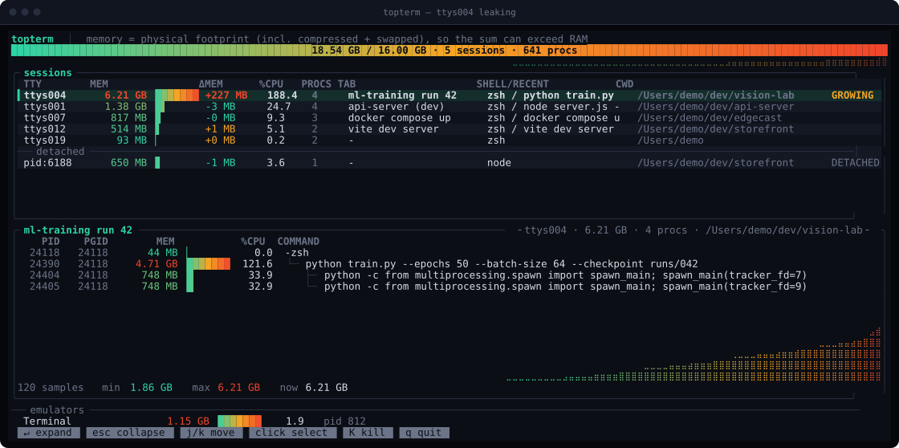
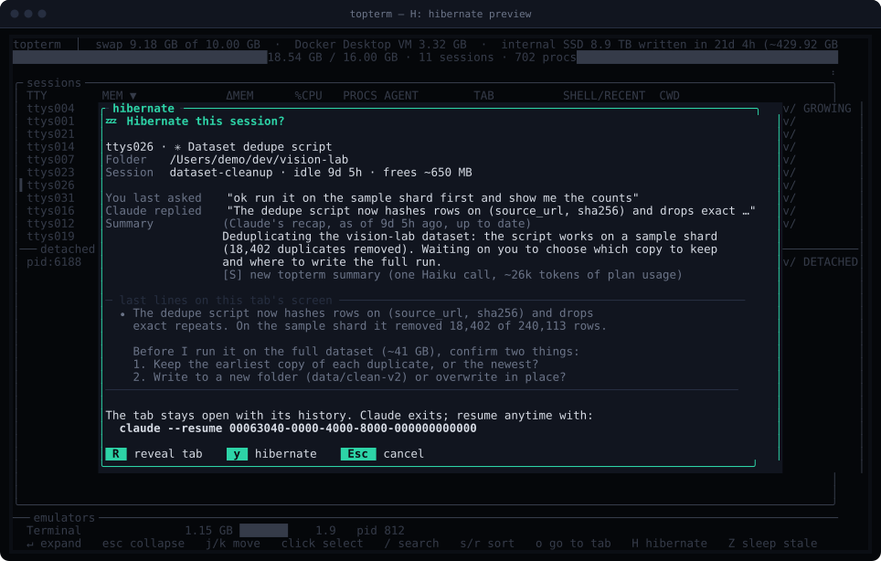
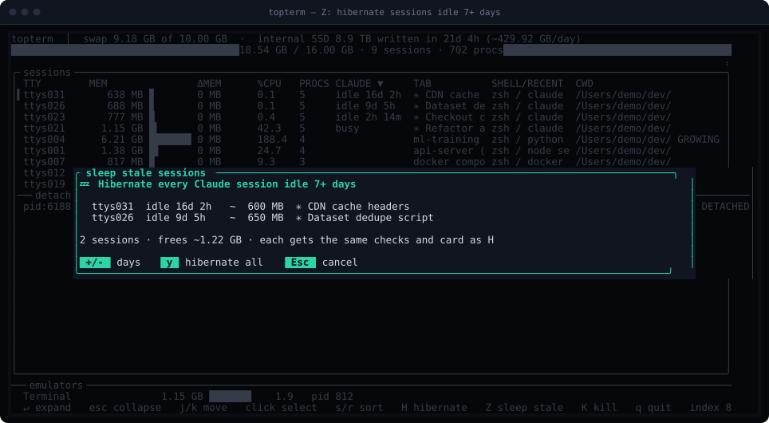
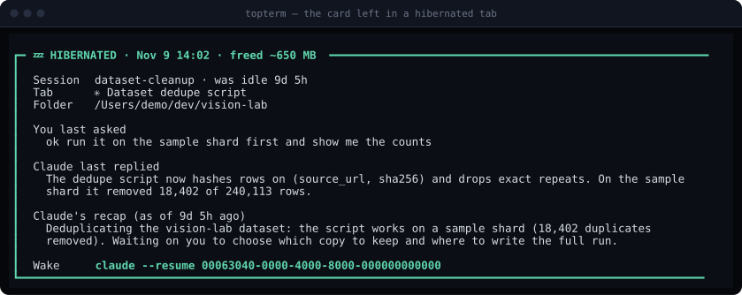

# topterm

**Activity Monitor for your terminal tabs, built for people running a lot of AI coding agents.**
Find which tab is eating your memory, see which Claude Code sessions have been idle for days,
and put them to sleep without closing the tab or losing the conversation.


## Features

**See where memory goes**
- **One row per terminal tab**, with everything running in it grouped: agents, dev servers, builds, ssh.
- **Real memory, not RSS.** Uses macOS's `phys_footprint`, so swapped-out memory still counts.
- **Swap and SSD wear** in the header: swap used, and how much has been written to the internal SSD per day since boot.
- **Scrollback per tab** (`--scrollback`): which tab's history is bloating Terminal.app.
- **Duplicate MCP servers**: the same server running once per Claude session, with the total memory.
- **Leak detection**: a pulsing `GROWING` flag on sessions that gained 50 MB+ recently, plus a memory trend per session.

**Manage Claude Code sessions**
- **CLAUDE column**: busy or idle, and for how long (`idle 9d 4h`). Sort to find forgotten sessions.
- **Hibernate one session (`H`)**: preview what it was doing first, then end Claude and keep the tab. A card in the tab shows the folder, last ask, recap and the `claude --resume` line.
- **Hibernate everything stale (`Z`)**: every session idle 7+ days (adjustable) in one go.
- **Safe by design**: skips busy sessions, sessions running anything besides MCP or language servers, and sessions with unsent text in the input box. Re-checks everything right before acting.
- **Go to tab (`o`)**: bring the selected session's Terminal tab to the front.

**Never lose track of a tab**
- **Tab index**: a markdown map of every tab's folder, Claude session, resume command and recap. It refreshes itself every 20 minutes while the TUI is open.
- **Uses Claude's own recap** when the session has one; otherwise topterm writes a short summary with Haiku on low effort, which never touches the conversation.
- **Never closes a tab or clears scrollback.** Everything is read-only except actions you confirm.

**Built for the terminal**
- **Sort by any column**, by key or by clicking the header. Mouse support throughout.
- **One-shot table** for scripts and pipes, or the live TUI with `-t`.
- **Three dependencies**, no daemon, no root.



## Quick guide

| You want to… | Do this |
|---|---|
| See which tab is using the most memory | `topterm -t`. Rows are tabs, biggest first. |
| Find Claude sessions you forgot about | Click the **CLAUDE** header (or press `s` until it's sorted). Longest idle first. |
| Free one idle session's memory, keep the tab | Select it, press `H`, check the preview, press `y`. |
| Free every session idle a week or more | Press `Z`, check the list (`+`/`-` change the days), press `y`. |
| Jump to a session's tab | Select it, press `o`. |
| Bring a hibernated session back | Run the `Wake` line printed in its tab: `claude --resume <id>`. |
| Close tabs without losing track of them | Nothing to do: with `topterm -t` open, the tab map at `~/Library/Application Support/topterm/index.md` refreshes itself every 20 minutes. |
| See which tab's scrollback is bloating Terminal | `topterm --scrollback` |
| See duplicate MCP servers | `topterm` (the one-shot table lists them under *MCP servers*). |

Everything is read-only except the actions you confirm (`H`, `Z`, `K`). topterm never closes
a tab or clears its scrollback.

<table>
<tr>
<td width="50%"><br><sub><b>H</b>: preview before hibernating one session</sub></td>
<td width="50%"><br><sub><b>Z</b>: hibernate everything idle 7+ days</sub></td>
</tr>
<tr>
<td colspan="2"><br><sub>What a hibernated tab shows: what it was doing and how to wake it</sub></td>
</tr>
</table>

And the one-shot plain table:

```
topterm  9 terminal sessions, 702 processes  |  memory 18.54 GB of 16.00 GB physical
memory = physical footprint (incl. compressed + swapped), so the sum can exceed RAM
swap 9.18 GB of 10.00 GB  ·  internal SSD 8.9 TB written in 21d 4h (~429.92 GB/day)

TTY               MEM      ΔMEM   %CPU PROCS CLAUDE       TAB                 SHELL/RECENT       CWD
ttys004       6.21 GB   +227 MB  188.4     4              ml-training run 42  zsh / python trai… /Users/demo/dev/visi…   ← GROWING
ttys001       1.38 GB     -3 MB   24.7     4              api-server (dev)    zsh / node server… /Users/demo/dev/api-…
ttys021       1.15 GB     -2 MB   42.3     5 busy         ✳ Refactor auth mi… zsh / claude       /Users/demo/dev/api-…
ttys007        817 MB     -0 MB    9.3     3              docker compose up   zsh / docker comp… /Users/demo/dev/edge…
ttys023        777 MB     -1 MB    0.4     5 idle 2h 14m  ✳ Checkout copy tw… zsh / claude       /Users/demo/dev/stor…
ttys026        688 MB     -1 MB    0.1     5 idle 9d 5h   ✳ Dataset dedupe s… zsh / claude       /Users/demo/dev/visi…
ttys031        638 MB     -1 MB    0.1     5 idle 16d 2h  ✳ CDN cache headers zsh / claude       /Users/demo/dev/edge…
ttys012        514 MB     +1 MB    5.1     2              vite dev server     zsh / vite dev se… /Users/demo/dev/stor…
ttys019         93 MB     +0 MB    0.2     2              -                   zsh                /Users/demo

terminal emulator apps (scrollback buffers)
Terminal                1.15 GB    1.9  pid 812  (app itself, not a tab)

MCP servers (every Claude session starts its own copy)
SERVER                        TABS  PROCS        MEM  ORPHANED
weather-mcp                      4      8     678 MB  -
notes-tool mcp                   4      4     207 MB  -

detached (reparented to launchd - no tab to blame, kill by pid)
pid:6188       650 MB    3.6     1  node /Users/demo/dev/storefront/node_modules/next/dist/server/next-server.js
                                    --port 3000
```

<sub>Every screenshot and the table are real `topterm` output rendered against a synthetic machine (`--fake-data`), so nobody's actual tabs, paths, or conversations ship in this repo.</sub>

## The problem

You have a MacBook with 18 GB of RAM and your terminal is using 25 GB. Activity Monitor shows dozens of anonymous `node` and `python` processes, but not which tab owns them or which one is leaking. `top`, `htop`, and Activity Monitor all show a flat process list — none of them know what a terminal tab is.

`topterm` does. Every tab gets a pseudo-terminal (`ttys000`, `ttys001`, ...), and every process a tab spawns hangs off that tty's process tree. `topterm` groups the entire process table by tab, sums memory and CPU per tab, looks up each tab's actual *title* and working directory, and sorts the hogs to the top. The leaky tab identifies itself in one screen.

## Install

The easy way — an interactive onboarding wizard that checks macOS, Xcode
Command Line Tools, and Rust, offers to install whatever's missing, then
walks you through building and linking the binary:

```sh
curl -fsSL https://raw.githubusercontent.com/Comradery64/topterm/main/scripts/onboard.sh | bash
```

(Or, from a clone: `./scripts/onboard.sh`.) It's plain arrow-key/number menus,
no extra dependencies. It also runs non-interactively for scripting/CI —
`./scripts/onboard.sh --build-link`, `--build`, `--test`, `--demo`, or
`--install-rust` each do one thing and exit.

Already have Rust? One line:

```sh
cargo install --git https://github.com/Comradery64/topterm
```

That builds and drops the `topterm` binary in `~/.cargo/bin`, which a standard
`rustup` install already puts on your `PATH` — so `topterm` just works in a new
shell. (If it doesn't, add `~/.cargo/bin` to your `PATH`.)

Or build from a clone by hand:

```sh
git clone https://github.com/Comradery64/topterm && cd topterm
make setup   # checks macOS, Xcode CLT, and Rust are present; add --install to have
             # it install the Rust toolchain via rustup if missing:
             # ./scripts/bootstrap.sh --install
make build
ln -s "$PWD/target/release/topterm" ~/.local/bin/topterm
```

Requires macOS and Rust. Three dependencies (`ratatui`, `crossterm`, `libc`) — no daemon, no root, no kernel extension. It reads the same `ps`/`lsof`/`sysctl` output you could read yourself, just ten thousand times faster.

## Use

```sh
topterm                          # one-shot table, sorted by memory, pipe-friendly
topterm -t                       # the TUI
topterm --index > tabs.md        # read-only map of every tab and its Claude session
topterm --summarize > tabs.md    # same, plus a short recap per session
```

### Memory details

- **CLAUDE column**: `idle 4d 16h` / `busy` for the Claude Code session in each tab, read from
  `~/.claude/sessions/<pid>.json` (and cc-mirror variants).
- **Swap and SSD writes** in the header: swap used, and bytes written to the internal SSD since
  boot with a per-day average, from the disk's own counter (`ioreg`). Sustained swapping shows up
  here as hundreds of GB a day.
- **MCP servers**: every Claude session starts its own copy of each MCP server. The one-shot table
  lists each server with how many tabs run it, its processes, total memory, and any copies
  orphaned to `launchd` after their session ended.
- **`--scrollback`**: each tab's Terminal.app scrollback in characters, with an estimate of its
  share of Terminal's memory (proportional to characters, so it is an estimate). Takes ~10s with
  100+ tabs; the TUI refreshes it every 5 minutes.

### Hibernate (TUI, `H`)

Exit an idle Claude session without closing its tab. Select a row and press `H` for a preview:

- folder, session name, idle time, and the memory exiting would free
- the last prompt you typed and Claude's last reply, read from the transcript
- Claude's own latest recap from the transcript, or topterm's cached summary if Claude never
  wrote one, labelled with its source, age, and how many messages came after it
  (`S` makes a fresh topterm summary with one Haiku call)
- the last lines currently on that tab's screen
- `R` brings the tab to the front so you can look before deciding

`y` hibernates. It refuses if Claude is busy or is running anything besides MCP servers,
language servers, and `caffeinate`, and right before acting it re-checks that the same Claude
process is still on that tab, on the same conversation, and idle, and that Claude's input box is
empty (an unsent draft is never thrown away). It then sends Claude SIGTERM, which exits it cleanly
along with its MCP servers (nothing is typed into the tab), waits for it to quit, and prints a card in the tab with the folder, last ask, summary,
and the `claude --resume <id>` line. The tab and its history stay.

### Hibernate stale sessions (TUI, `Z`)

`Z` lists every Claude session idle for 7+ days (change the default with
`--stale-days N`, or `+`/`-` in the overlay), oldest first, with what each would free and
any that would be skipped because they're running something. `y` works through them one at a
time with exactly the same checks and card as `H`, showing each result as it goes.

### The tab index

Too many tabs to close safely? topterm keeps a markdown map of every tab at
`~/Library/Application Support/topterm/index.md`, so closing a tab never means losing
track of it. You don't run anything: whenever `topterm -t` is open it rebuilds the map at
launch if it's 20+ minutes old, and again every time it reaches 20 minutes (no model calls).
The footer shows its age. `topterm --index` prints the same map to stdout on demand. Tabs are grouped by folder.
(There is no reliable window/tab position to show: with macOS native tabs every tab is its
own scripting "window", numbered by recent focus.) Per tab:

- the tab's title and working directory
- the Claude Code session it holds: live sessions are read from
  `~/.claude/sessions/<pid>.json`; exited ones from the `claude --resume <id>`
  line Claude prints on exit (last 6,000 characters of scrollback)
- cc-mirror variants
  (`~/.cc-mirror/<name>/config`) are recognised, and their resume command uses
  the variant's own launcher, e.g. `work --resume <id>`

Every entry includes Claude Code's own recap when the transcript has one (the
"while you were away" text it writes as an `away_summary` record): free, no model call,
labelled with its age. `--summarize` fills in only the sessions without one, adding one or
two sentences per session. Each recap is a one-off
`claude -p --model haiku --effort low --no-session-persistence` call with tools
and MCP disabled, fed a trimmed copy of the transcript. It never resumes the
original session, adds nothing to it, and saves no new session. Recaps are
cached in `~/Library/Caches/topterm/summaries` by session id and transcript
size, so re-runs only pay for sessions that changed. While it runs, each Haiku
call briefly appears as a live Claude session to your other sessions.

Both modes only read. Nothing is closed, cleared, or signalled.

### The TUI

`topterm -t` is interactive:

- **Live gradient RAM gauge** across the top — summed terminal memory vs. physical, with a sparkline of the machine-wide trend.
- **Click any row** (mouse support) or press `Enter` to expand a session into its full process tree with memory bars and a four-minute memory trend. Leaks show up as a line that only goes up.
- **`GROWING` flags pulse** on sessions that gained 50 MB+ across recent samples. That's the leak signature.
- **Press `K`** on a session to kill it: you get a confirmation overlay showing every process group it will SIGTERM, and nothing happens until you press `y`.
- Panel expansion animates at 30 fps while something is moving. Idle, it wakes once per sampling interval.

| Key | Action |
|---|---|
| click / `↑↓` / `j k` | select session |
| `Enter` / click again | expand / collapse detail |
| `s` / `r` / click a header | sort by that column / reverse (click the same header again to reverse) |
| `o` | bring the selected session's Terminal tab to the front |
| `Z` | hibernate every Claude session idle 7+ days (`+`/`-` adjust, `y` run) |
| `H` | hibernate preview for the selected Claude session (`R` reveal, `S` summary, `y` hibernate) |
| `K` then `y` | SIGTERM every process group in the session |
| `Esc` | collapse / cancel |
| `q` / `Ctrl-C` | quit |

### Flags

| Flag | |
|---|---|
| `-t`, `--tui` | interactive TUI (default is a one-shot plain table) |
| `--stale-days N` | threshold for `Z` in the TUI (default 7) |
| `--scrollback` | also measure each tab's Terminal.app scrollback (~10s) |
| `--interval SECS` | TUI sampling interval (default 2) |
| `--wide` | never truncate commands or paths |
| `--no-color` | plain output |
| `--demo-frame` | render one styled TUI frame as ANSI to stdout and exit (used by the test suite to assert on the visuals) |
| `--index` | print a read-only markdown map of every Terminal.app tab (see above) |
| `--summarize` | `--index` plus a Haiku recap per Claude session |
| `--fake-data` | render a synthetic machine instead of sampling this one — how the screenshot and table above were generated |

## How it knows which tab is which

Three tricks, all boring and reliable:

1. **TTY grouping.** `ps -axo pid,ppid,pgid,tty,%cpu` gives every process's controlling terminal. Processes that detached from their tty (`??`) get attributed by walking their ancestry back to a tab's shell — so a runaway child your dev server forked three levels deep still counts against the right tab.
2. **Tab titles via AppleScript.** Terminal.app and iTerm2 both expose the tty of every tab, so one `osascript` call per refresh maps `ttys012` to the title you actually see. (First run may ask for Automation permission — approve once. Fun fact discovered building this: inside a `tell application "Terminal"` block, AppleScript's `tab` means the *tab object*, not the tab character.)
3. **Working directories** via one batched `lsof -d cwd` call — many tabs lack titles, and the path is how you recognize them. A tab whose folder was deleted shows `(folder deleted)`.

Memory is each process's **physical footprint** (`proc_pid_rusage`, the number Activity Monitor shows), not RSS. RSS only counts pages currently in RAM, so on a machine that is swapping it hides most of what a tab really holds. Processes you may not inspect fall back to RSS.

Two categories fall outside per-tab grouping:

- **Detached hogs** — subtrees that lost their tab and reparented to `launchd`. No tab to blame, but they're listed with full command lines and PIDs, because they are frequently the actual leak.
- **The emulator itself** — Terminal.app / iTerm2 / kitty / Alacritty / WezTerm / Ghostty, since gigabytes of scrollback live there, not in any tab.

## FAQ

**Why does the memory total exceed my physical RAM?**
Physical footprint includes memory macOS has compressed or swapped to disk. If the total is well above your RAM, you are swapping, which is exactly when a slow terminal starts to hang.

**Why does the "out of application memory" dialog blame a tiny app for gigabytes?**
macOS groups memory by responsible app. A program launched from a terminal tab, including one Claude Code starts by running its binary, is counted with Terminal, so the dialog can show Terminal's whole total next to it. Launch apps with `open MyApp.app` to give them their own row.

**Does it only track dev tools?**
No — grouping is completely tool-agnostic. Anything a tab runs gets counted: dev servers, docker, ssh, a stuck `npm install`. Only the detached-orphan section filters to dev-tool-looking commands, to keep macOS system daemons out of your face.

**tmux?**
tmux panes get their own ttys under the tmux server, so they group under the server rather than the tab that launched tmux. Known limitation.

**Linux?**
macOS only for now — the `ps`/`lsof`/`sysctl` invocations and the AppleScript tab-title lookup are Darwin-specific. The grouping logic would port; PRs welcome.

**Is the kill feature safe?**
It SIGTERMs (never SIGKILL) each process group after an explicit per-group confirmation, and the overlay auto-cancels if the target session disappears between refreshes. It will never signal a group it didn't show you first.

## Related tools

topterm isn't the only monitor for AI coding agents. If you mainly want token, cost, or
context-window tracking per session, look at [abtop](https://terminaltrove.com/abtop/),
[agentop](https://github.com/dadwadw233/agentop), [agenttop](https://github.com/tech4242/agenttop),
[clankmon](https://github.com/rydn/clankmon), or [cltop](https://github.com/chrbailey/cltop).
[clauditor](https://github.com/jarredkenny/clauditor) can pause and resume sessions,
[RAM Sleeper](https://kejid.github.io/ramsleeper/) unloads idle sessions, and
[mcp-sprawl-audit](https://github.com/karanb192/mcp-sprawl-audit) counts duplicate MCP servers.

topterm's angle is the terminal tab: it groups *every* process by the tab that owns it (agents,
dev servers, builds, ssh), attributes Terminal.app's scrollback memory to tabs, measures physical
footprint rather than RSS, and hibernates a session while leaving its tab, history, and a resume
card in place.

## Contributing

PRs welcome. The project is MIT, there's no CLA, and the only hard gate is that
`cargo test` passes — CI runs `cargo build` and `cargo test` on macOS.

**A Linux port is the most-wanted contribution.** `src/collector.rs` is the only
Darwin-specific file in the tree: everything platform-dependent lives in its
`ps`/`lsof`/`sysctl` invocations and the AppleScript tab-title lookup. The
grouping, diffing, and rendering logic above it is portable as-is, so a port is
mostly a matter of teaching the collector a second way to fill the same structs
(`/proc` plus your terminal's own tty mapping).

Working on the visuals? `topterm --fake-data --demo-frame` renders a single
styled TUI frame against the synthetic machine in `src/fake.rs`, and `tools/`
holds the stdlib-only scripts that turn that frame into `assets/demo.svg` and
regenerate the plain-text table in this README. See [tools/README.md](tools/README.md)
for the two commands. Please keep demo assets generated from `--fake-data` so no
real machine's tab titles or paths land in the repo — `cargo test` enforces that
the fake data only ever references `/Users/demo`.

## License

MIT — see [LICENSE](LICENSE).

---

Built because a 25 GB terminal on an 18 GB laptop is a solvable problem.
